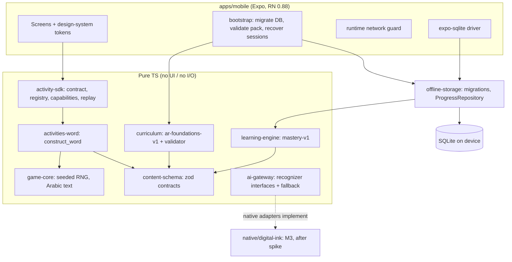

# Architecture overview (M1)

Huroofi is an offline-first Expo app over a set of pure TypeScript packages. Learning rules, scheduling and persistence never depend on UI, network or AI.



## Dependency rules (enforced by `pnpm lint`)

| Package group                                                                                  | May import                      | Must not import                                                                                                                         |
| ---------------------------------------------------------------------------------------------- | ------------------------------- | --------------------------------------------------------------------------------------------------------------------------------------- |
| content-schema, game-core, curriculum, activity-sdk, activities-*, learning-engine, ai-gateway | each other, zod                 | react, react-native, expo, zustand, any SQLite module, `offline-storage`, any HTTP client; `fetch`/`XMLHttpRequest`/`WebSocket` globals |
| offline-storage                                                                                | content-schema, learning-engine | UI modules, HTTP clients, network globals                                                                                               |
| apps/mobile                                                                                    | everything                      | (network calls are blocked at runtime and by the static guard)                                                                          |

The static guard (`pnpm guard:offline`) also fails CI on tracking/ads SDKs, camera/microphone/location permissions, and remote URLs in source.

## Workspace layout (current)

```text
apps/mobile                 Expo app shell (M1)
packages/content-schema     zod contracts: GameEvent, EvaluationResult, Mastery, curriculum, assets, repository
packages/game-core          seeded RNG/shuffle, Arabic segmentation + feature detection
packages/activity-sdk       ActivityDefinition, registry, CapabilityRegistry, replay
packages/activities-word    construct_word rules engine (UI in M2)
packages/curriculum         ar-foundations-v1 draft pack + quality-gate validator
packages/learning-engine    mastery-v1 updater (scheduler in M3)
packages/offline-storage    migrations, serialized SQL driver, SqliteProgressRepository
packages/design-system      tokens + a11y helpers
packages/ai-gateway         HandwritingRecognizer, PhysicalTileRecognizer (reserved), guards
tooling/content-validator   CI curriculum gate
tooling/offline-network-guard  CI offline/privacy gate
```

Planned and not created yet, per milestone: `activities-audio`, `audio-engine`, `mascot` (M2); `activities-trace`, `handwriting-engine`, `native/digital-ink` (M3); `interaction-core` (when a second input adapter exists), `asset-pipeline`, `device-benchmarks`, `apps/asset-preview` (as needed). Empty placeholder packages were not created on purpose.

## Key decisions

- Workspace packages ship TypeScript source (`main: src/index.ts`) with no build step. Metro, Vitest, Jest and tsx all consume them directly.
- Contracts follow plan §6. Where the §7 schema needs more fields than the §6.3 `recordAttempt` signature (activity type/version, input source, response time), the contract was extended rather than inventing values at write time. See `RecordAttemptInput`.
- `recordAttempt` is one transaction: attempt, evidence and mastery. It is idempotent on `attemptId`, safe under concurrent double taps, and rejects attempts for closed sessions or a session owned by another child.
